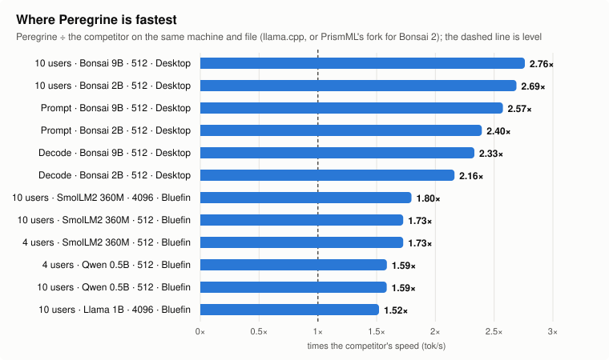

<div align="center">

# Peregrine

**A CPU inference engine for language models, built to be the fastest on the hardware people already have.**

[](https://github.com/RantAI-dev/peregrine/actions/workflows/ci.yml)
[](LICENSE)
[](Cargo.toml)

</div>

Peregrine runs GGUF models on CPUs, in pure Rust with one runtime dependency (`memmap2`). It reports the
**bytes it moved per token** beside tokens per second, so every number can be checked against the machine's
own memory-bandwidth ceiling.

> **Status: early.** The engine works and is measured, but the API, CLI and crate layout will change as the [roadmap](docs/roadmap.md) lands.

## Biggest wins

Against the fastest engine that runs the same file on the same machine and thread count:
llama.cpp v0.9.0 for the Q4_K_M models, and for the ternary files upstream llama.cpp cannot
load, PrismML's llama.cpp fork.



- **Single-user decode up to 1.39× faster** (Llama 3.2 1B at a 4096-token context, 12-core desktop),
  and ahead in 9 of 10 confirmed cases. Against llama.cpp's faster flash-attention setting the 1B is
  1.21× ahead at 512 tokens and 1.39× at 4096 on the desktop. On the 4-core Ryzen 3 all three models
  are ahead: Llama 3.2 1B 1.10× and 1.26×, Qwen 2.5 0.5B 1.07× and 1.26×, SmolLM2 360M 1.15× and
  1.34×. The only decode loss is the 0.5B at 512 on the desktop (0.92×). The lead grows with
  context: attention reads each cached key and value once per group of heads.
- **Up to 1.80× the throughput with 10 users at once** on a 4-core Ryzen 3 (SmolLM2 360M at 4096;
  1.73× at 512), and 1.47× on Llama 3.2 1B at 512 (1.52× at 4096), against llama.cpp's faster
  setting.
- **Prompt processing ahead on Q5_0-heavy files and level on the 1B** on bluefin: 1.43× and 1.17× on
  Qwen 2.5 0.5B, 1.39× and 1.05× on SmolLM2 360M, 1.03-1.04× on Llama 3.2 1B, after the Q5_0
  kernels (#103-#105). The desktop is at 0.69-0.74×.
- **Bonsai 2 (ternary): 1.4-2.3× the decode and 1.9-2.6× the prompt speed of PrismML's own
  llama.cpp fork, 1.8-2.7× with 10 users** (12-core desktop and 4-core bluefin; the AVX2
  bluefin sits at the bottom of the decode range), against the fork's faster flash-attention
  setting for each row. Upstream llama.cpp cannot load these PQ2_0 files, so the fork is the
  only comparison that exists for them.

Losses are in the same report: on the desktop, the 0.5B at 512 tokens (0.92× decode), prompt
processing (0.69-0.74×) and multi-user throughput (0.87× at 10 users, 0.95× at 4); and on bluefin,
time to first token with 10 users for the 1B at 4096 (1.04×). At 512 Peregrine is faster on all three
TTFT rows, and at 4096 on the two small models. No bluefin throughput row is below 1.0×. Every
number, chart and machine record is in [docs/benchmark.md](docs/benchmark.md).

## Progress

As of November 2026; the plan with every item is in the [roadmap](docs/roadmap.md).

| Stage | Where it stands |
|---|---|
| 0. Groundwork | done: the release step and the AVX2-host release gate are written down (`docs/dev/releasing.md`) |
| 1. Structure | done: the kernel table, shared layer blocks, one runtime, feature flags, `peregrine tune` |
| 2. Breadth | done for the architectures, formats and templates in the table below; open: a real gpt-oss file, startup calibration, ARM (not yet decided) |
| 3. Speed and proof | under way: the benchmark harness, a first desktop baseline against llama.cpp and the KL check per model are in; the first kernel and scheduling speed-ups have landed |

Speed-ups that landed in November 2026:

- **Q5_0 kernels** (#103 wide prefill, #104 eight-row Q5_0/Q8_0 decode GEMV, #105 repacked tiles):
  on a Ryzen 3 PRO 4350G, Qwen 2.5 0.5B (a mostly-Q5_0 file) goes from 52.9 to 83.5 tok/s decode and
  263 to 435 tok/s prompt at 512 tokens (+58% and +65%), and from 45.2 to 65.9 decode and 198 to 278
  prompt at 4096 (+46% and +40%); 10-user throughput rises 51% and 46%. The Llama 3.2 1B file has no
  Q5_0 tensors and stays within 2% on every row, as expected.
- **Repacked Q4_K kernels** (AVX2): prompt processing on a Ryzen 3 PRO 4350G goes from 104 to 152 tok/s
  on Llama 3.2 1B and from 72 to 96 tok/s on Qwen 3.5 2B; decode is unchanged. The Q5_0 tile takes
  the small models' prefill further (Qwen 0.5B 1.69× at 512). On the AVX-512 host the repack is on
  by default too: the 1B's prompt is +26% at 512 tokens for −1.2% decode, and the 0.5B (Q4_K + Q5_0)
  is +19.7% prompt and +18.7% decode (`PEREGRINE_KREPACK=0` is the control).
- **The prefill chunk follows the worker pool**: on the Ryzen AI 9 HX 370, prompt processing is 14-43%
  faster (Bonsai 2 2B +43%, Bonsai 2 9B +14%, Llama 3.2 1B +19%).
- **More attention tasks at short context**: decode is 0.6-2.9% faster, and a row's attention no longer
  depends on the other rows in the batch.

Next: the AVX-512 repacked Q4_K kernel, repacked Q6_K, a real gpt-oss file, a baseline on the third
host, and the task-accuracy gate.

## Why

- **Measured, not claimed.** Every result is reported as a fraction of the host's roofline, with the exact
  command, commit and options that produced it. Losses are published along with wins.
- **Lossless by default.** Speculation, batching and every kernel produce the same tokens as the exact
  reference path. Anything lossy is off by default and ships with its own accuracy report.
- **Many users, one weight pass.** A batching scheduler with chunked prefill, a shared prefix cache and
  position-keyed sampling: a user gets identical text alone or alongside others.
- **Owned hot path.** Kernels, thread pool, cache, sampler, tokenizer and scheduler are this project's
  code, so their speed and correctness are under its control.

## What runs today

<!-- support:begin -->
| | Supported now |
|---|---|
| Architectures | Llama, Qwen 2, Qwen 3, Qwen 3.5 / Bonsai 2 (Gated DeltaNet hybrid, MTP), Gemma 3, Qwen 3 MoE, gpt-oss (synthetic check; real file pending), Phi-3 / Phi-4 |
| Weight formats | F32, F16, BF16, Q4_0, Q5_0, Q8_0, Q2_K, Q3_K, Q4_K, Q5_K, Q6_K, IQ4_NL, IQ4_XS, MXFP4, PQ2_0, PTQ1_0 |
| CPUs | x86-64 AVX2, AVX-VNNI (256-bit), AVX-512 (VNNI, GFNI, VBMI); others through scalar code |
| Tokenizers | GPT-2 byte-level BPE, SentencePiece (llama) |
| Chat templates | read from the model file and rendered exactly as llama.cpp renders them: ChatML, Phi-4, Llama 3, Qwen 3, Gemma, Mistral (v0, v1, v7), Llama 2, OpenAI Harmony (gpt-oss) — or named with `--chat-template` for a file that declares none |
<!-- support:end -->

### On the roadmap

- **CPUs**: AVX-VNNI-256, ARM NEON/SDOT
- **Chat templates**: more of llama.cpp's built-ins

Measured on a Ryzen AI 9 HX 370 (WSL2), Bonsai 2 9B: **23.5 tok/s single user, 28.7 with lossless MTP
speculation**, about 75 tok/s total at 10 users. The full table, method and competitors are in
[docs/targets.md](docs/targets.md).

Checked against llama.cpp v0.9.0 on the same file, for **Llama 3.2 1B Instruct** and **Qwen 2.5 0.5B
Instruct** (Q4_K_M): the tokenizer produces the same token ids, greedy decoding produces the same token
ids except where the top two logits are closer than the two implementations' own rounding difference,
and the chat path returns the same prompt token count and the same answer.

The same holds for the two SentencePiece families, **Llama 2 7B Chat** and **Mistral 7B Instruct
v0.2** (Q4_K_M): the tokenizer produces the same ids as llama.cpp's `llama-tokenize`, greedy decoding
produces the same ids except at one near-tie below the implementations' own logit spread, and the chat
path returns a byte-identical rendered prompt, the same prompt token count and the same answer.

The same holds for **Gemma 3 1B Instruct** (Q4_K_M): the tokenizer produces the same ids as
llama.cpp's `llama-tokenize` (22/22 strings), greedy decoding produces bit-identical token ids
across all 32 steps on all three prompts (including beyond the 512-token sliding window), and the
chat path returns a byte-identical rendered prompt, the same prompt token count and the same answer.

The same holds for **Qwen 3 MoE (Qwen3-30B-A3B)** (Q2_K): the tokenizer produces the same ids as
llama.cpp's `llama-tokenize` (22/22 strings), greedy decoding matches bit for bit on prompts 2 and 3
(32/32 steps) and through 26 tokens on prompt 1 (first divergence at a near-tie of 0.17 logit difference),
and the chat path returns matching answers with reasoning tokens.

The same holds for plain **Qwen 3.5 (Qwen3.5-2B)** (Q4_K_M): the tokenizer produces the same ids as
llama.cpp's `llama-tokenize` (22/22 strings), greedy decoding matches bit for bit on prompts 1, 2, and 4
(32/32 steps, including across a 602-token prompt) and through 27 tokens on prompt 3 (first divergence
at a near-tie of 0.045 logit difference), and the chat path returns matching answers with reasoning tokens.

The same holds for **Phi-4 (Phi 4, 14B)** (Q4_K_M): the tokenizer produces the same ids as
llama.cpp's `llama-tokenize` (22/22 strings), greedy decoding matches bit for bit on all three prompts
(32/32 steps each), and the chat path answers the same question the same way.

## Quick start

New here? [docs/quickstart.md](docs/quickstart.md) walks a first request end to end: a release
binary (or Docker), a small model, `curl` and the OpenAI Python client.

```sh
git clone https://github.com/RantAI-dev/peregrine && cd peregrine
cargo build --release
./target/release/peregrine inspect path/to/model.gguf      # what it is, and whether it runs
./target/release/peregrine bench -m path/to/model.gguf        # measure prefill & decode tok/s and bytes/token
./target/release/peregrine tune -m path/to/model.gguf         # tune execution knobs for host CPU and model
./target/release/peregrine serve -m path/to/model.gguf --port 8201
curl -s localhost:8201/v1/chat/completions -H 'content-type: application/json' \
  -d '{"messages":[{"role":"user","content":"Hello"}]}'
```

The server speaks the OpenAI chat API (`/v1/chat/completions`, streamed or not), plus `/v1/models`,
`/health` and `/metrics`.

### Building with fewer features

By default, Peregrine builds with all architectures, quantisation formats, and extras enabled. For embedded applications or smaller binaries, you can disable default features and pick only what you need:

```sh
# Dense Llama models only with K-quant formats:
cargo build --release -p peregrine --no-default-features --features cli,arch-llama,fmt-kquant

# Hybrid Qwen3.5 models with ternary formats:
cargo build --release -p peregrine --no-default-features --features cli,arch-qwen35,fmt-ternary
```

| Category | Features |
|---|---|
| Architectures | `arch-llama` (Llama), `arch-qwen` (Qwen 2/3), `arch-qwen35` (Qwen 3.5 hybrid) |
| Formats | `fmt-kquant` (Q2_K..Q6_K), `fmt-ternary` (PQ2_0, PTQ1_0), `fmt-iq` (IQ4_NL, IQ4_XS), `fmt-legacy` (Q4_0, Q5_0, Q8_0); F32/F16/BF16 always enabled |
| Extras | `littlebit` (LittleBit sidecars), `dspark` (speculative drafter), `mtp` (multi-token prediction head), `server` (OpenAI HTTP server), `cli` (CLI binary) |

## Documentation

| | |
|---|---|
| [Product](docs/product.md) | what Peregrine is, who it is for, what it will not do |
| [Quickstart](docs/quickstart.md) | a release binary or Docker, a model, and the first request |
| [Targets](docs/targets.md) | the speed, accuracy and support numbers we hold ourselves to |
| [Benchmarks](docs/benchmark.md) | Peregrine against llama.cpp, wins and losses, with charts |
| [Roadmap](docs/roadmap.md) | the plan, stage by stage |
| [Architecture](ARCHITECTURE.md) | a map of the code |
| [Contributing](CONTRIBUTING.md) | how to build, test, benchmark and send changes |
| [Decisions](docs/adr/README.md) | why things are the way they are |

## License

Apache-2.0. See [LICENSE](LICENSE) and [NOTICE](NOTICE). Contributions are accepted under the same license.
