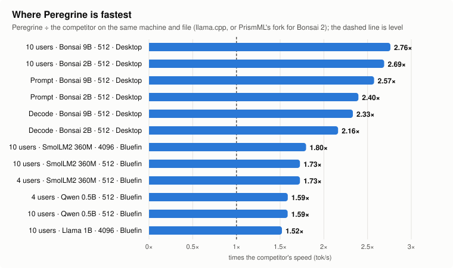
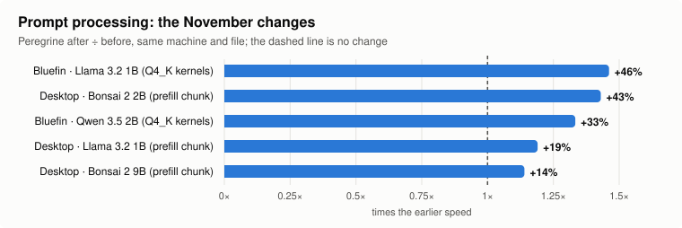

# Benchmarks: Peregrine against llama.cpp

Where Peregrine stands against llama.cpp on the same machine, the same model file and the same thread
count. Wins and losses are both here. The raw data, method and machine records are in
[`benchmarks/results/`](../benchmarks/results/); the targets these numbers are held to are in
[targets.md](targets.md).



## The short version

- **Single-user decode is Peregrine's strongest result.** It beats llama.cpp in 5 of the 8 confirmed cases,
  by up to 1.36× (Llama 3.2 1B at a 4096-token context on the desktop). The gap grows with context:
  Peregrine's attention reads each cached key and value once per group of heads, and spends about
  2.3× less time per context position than llama.cpp. On bluefin, against llama.cpp's faster
  flash-attention setting, the 1B is ahead 1.10× at 512 and 1.26× at 4096, while the 0.5B at 4096
  is now a loss (0.87×).
- **Many users on a small machine.** On the 4-core bluefin, Peregrine serves 10 users at once 1.48×
  faster than llama.cpp on Llama 3.2 1B at a 512-token context (1.52× at 4096), against llama.cpp's
  faster setting.
- **Prompt processing has caught up on AVX2.** On bluefin, with the repacked Q4_K kernels, Peregrine
  matches llama.cpp on Llama 3.2 1B (1.02-1.05×). On the desktop it is at 0.62-0.66×; the same
  kernels lift the desktop's Llama 3.2 1B from 0.66× to 0.81×, but they are not on by default there yet.
- **Where it loses:** the 0.5B model at both contexts on bluefin (decode 0.68× at 512 and 0.87× at
  4096; 0.90× at 512 on the desktop), prompt processing on the desktop, and multi-user throughput on
  the desktop (0.84×).

## The machines

| | Desktop (H1) | Bluefin (H2) |
|---|---|---|
| CPU | AMD Ryzen AI 9 HX 370 (Zen 5), 12 cores / 24 threads | AMD Ryzen 3 PRO 4350G (Zen 2), 4 cores / 8 threads |
| SIMD | AVX2, AVX-512 (VNNI, GFNI, VBMI) | AVX2 |
| Threads used | 12 (one per core) | 4 (one per core) |
| OS | Linux under WSL2 | Fedora, bare metal |
| Peregrine | `5f76d48` (2026-11-08), defaults: repacked Q4_K kernels off | `9bcf524` (2026-11-08; engine sources unchanged since `5f76d48`), defaults: repacked Q4_K kernels on |
| Results | [desktop-zen5-2026-11-08](../benchmarks/results/desktop-zen5-2026-11-08/README.md) | [bluefin-zen2-2026-11-08-fa-off](../benchmarks/results/bluefin-zen2-2026-11-08-fa-off/README.md) |

The desktop's same-day llama.cpp ran 0-7% faster than on 2026-11-07
([first desktop baseline](../benchmarks/results/desktop-zen5-2026-11-07/README.md)), so compare
ratios measured on the same day, not numbers across days.

Both run llama.cpp v0.9.0 (`cd959ba`) as a server against Peregrine's server, with 256 greedy tokens
per request, prompts calibrated to the target context, three interleaved rounds and the median
reported. The models are the Q4_K_M files of Llama 3.2 1B Instruct and Qwen 2.5 0.5B Instruct, with
the same file (by SHA-256) for both engines.

**Each ratio is against llama.cpp's faster flash-attention setting for that row.** llama.cpp
defaults to `-fa auto`, which resolves to flash attention on here; that path is slower for
single-user decode, and `-fa off` is used for those rows, while the default is faster for prompt
processing and multi-user throughput and is used there. The default-setting number is kept as a
secondary note. The bluefin re-run and both settings are in
[`bluefin-zen2-2026-11-08-fa-off`](../benchmarks/results/bluefin-zen2-2026-11-08-fa-off/README.md).

Desktop llama.cpp numbers on this page were taken at its defaults and are being re-checked with
flash attention off; the bluefin rows below already use the faster setting.

## Single-user decode


| Machine | Model | Context | Peregrine | llama.cpp | Peregrine ÷ llama.cpp |
|---|---|---|---|---|---|
| Desktop | Llama 3.2 1B | 512 | 59.4 | 51.0 | **1.16×** |
| Desktop | Llama 3.2 1B | 4096 | 44.2 | 32.4 | **1.36×** |
| Desktop | Qwen 2.5 0.5B | 512 | 68.1 | 75.8 | 0.90× |
| Desktop | Qwen 2.5 0.5B | 4096 | 51.6 | 48.8 | **1.06×** |
| Bluefin | Llama 3.2 1B | 512 | 46.1 | 42.0 | **1.10×** |
| Bluefin | Llama 3.2 1B | 4096 | 36.9 | 29.3 | **1.26×** |
| Bluefin | Qwen 2.5 0.5B | 512 | 52.9 | 77.4 | 0.68× |
| Bluefin | Qwen 2.5 0.5B | 4096 | 45.2 | 52.0 | 0.87× |

Tokens per second. Bluefin compares against llama.cpp's faster flash-attention setting: `-fa off`
for these rows. Against llama.cpp's defaults the same rows are 1.17×, 2.83× (13.0 tok/s), 0.71× and
1.10× (41.0 tok/s). The Qwen 0.5B at 4096 is a loss now that the default is not the competitor: with
`-fa off` llama.cpp decodes at 52.0 tok/s, above Peregrine's 45.2. Desktop numbers are at llama.cpp's
defaults until its re-check lands.

Why the 0.5B loses at a short context: with only two KV heads its attention splits into fewer tasks
than there are cores, and a few steps in each layer still run on one thread. Both matter more on a
small model, where each token's weight pass is short.

## Prompt processing


| Machine | Model | Context | Peregrine | llama.cpp | Peregrine ÷ llama.cpp |
|---|---|---|---|---|---|
| Desktop | Llama 3.2 1B | 512 | 173.5 | 262.0 | 0.66× |
| Desktop | Llama 3.2 1B | 4096 | 125.4 | 189.0 | 0.66× |
| Desktop | Qwen 2.5 0.5B | 512 | 270.6 | 435.2 | 0.62× |
| Desktop | Qwen 2.5 0.5B | 4096 | 184.9 | 279.4 | 0.66× |
| Bluefin | Llama 3.2 1B | 512 | 197.3 | 188.3 | **1.05×** |
| Bluefin | Llama 3.2 1B | 4096 | 144.6 | 141.2 | **1.02×** |
| Bluefin | Qwen 2.5 0.5B | 512 | 263.2 | 302.9 | 0.87× |
| Bluefin | Qwen 2.5 0.5B | 4096 | 198.2 | 236.0 | 0.84× |

On bluefin, llama.cpp's default (`-fa auto` on) is faster than `-fa off` for prompt processing
(`-fa off` gives 173.6 and 122.2 tok/s on the 1B, 277.1 and 192.9 on the 0.5B), so the default is
the like-for-like competitor here.

On the desktop the repacked Q4_K kernels are off by default (AVX-512 has no kernel of its own yet).
Turned on with `PEREGRINE_KREPACK=1`, Llama 3.2 1B goes to 211.5 tok/s at 512 (0.81×) and 144.6 at
4096 (0.77×), and its 10-user throughput to 62.7 tok/s (1.02×), with decode within 1%. The 0.5B
does not gain from them.

## Many users at once


| Machine | Model | 4 users | 10 users | 10 users, Peregrine ÷ llama.cpp |
|---|---|---|---|---|
| Desktop | Llama 3.2 1B | 52.9 vs 54.5 | 51.8 vs 61.7 | 0.84× |
| Desktop | Qwen 2.5 0.5B | 70.6 vs 81.8 | 78.0 vs 93.4 | 0.84× |
| Bluefin | Llama 3.2 1B | 53.8 vs 39.6 | 55.2 vs 37.4 | **1.48×** |
| Bluefin | Qwen 2.5 0.5B | 70.7 vs 65.2 | 71.7 vs 68.7 | **1.04×** |

Total tokens per second over all users at a 512-token context, Peregrine vs llama.cpp. On bluefin
the default is the faster llama.cpp setting for multi-user throughput: `-fa off` drops it to 34.2
and 23.9 tok/s (1B, 4 and 10 users) and 55.0 and 42.5 tok/s (0.5B), so these ratios use the default.
At 4096 tokens the 1B is 7.65 vs 5.36 (4 users, 1.43×) and 7.73 vs 5.07 (10 users, 1.52×); the 0.5B
is 9.97 vs 10.88 (0.92×) and 9.81 vs 10.13 (0.97×). The 10-user, 4096, `-fa off` phase does not
finish inside the 10-minute command cap on this host, so those two rows use the default, which is
already about 2× faster at 4 users there. At 4096 tokens both engines fall to 5-14 tok/s in total,
too coarse to compare closely; those numbers are in the result folders.

## What changed in November



Peregrine against its own earlier build on the same machine and file:

| Change | Machine | Model | Prompt processing |
|---|---|---|---|
| Repacked Q4_K kernels (#88) | Bluefin | Llama 3.2 1B | 104 → 152 tok/s (+46%) |
| Repacked Q4_K kernels (#88) | Bluefin | Qwen 3.5 2B | 72 → 96 tok/s (+33%) |
| Prefill chunk follows the worker pool (#92) | Desktop | Bonsai 2 2B | +43% |
| Prefill chunk follows the worker pool (#92) | Desktop | Llama 3.2 1B | +19% |
| Prefill chunk follows the worker pool (#92) | Desktop | Bonsai 2 9B | +14% |

Decode also moved by +0.6% to +2.9% with the finer attention split (#94). The prefill chunk and the attention
split leave the output bit for bit the same; the repacked kernels round differently, and their KL
divergence against llama.cpp stayed flat on every model checked.

## Reproducing

```sh
python3 benchmarks/run.py --help     # the harness: one engine, one model, the four numbers
python3 benchmarks/charts.py         # redraws the charts on this page from the numbers in it
```

Pass `--llama-fa off` (or `on`) to pin llama.cpp's flash attention; the default `auto` reproduces
llama.cpp's own default. The choice is written to the run manifest. Ratios on this page use the
faster setting per row.

The charts are drawn by [`benchmarks/charts.py`](../benchmarks/charts.py) from the medians in the
result folders; update its tables when a new result lands, then rerun it.

## Bonsai 2 vs PrismML's fork

Bonsai 2's ternary files (PQ2_0, ggml type 142) do not load in upstream llama.cpp, so the
llama.cpp comparison above cannot cover them. [PrismML's
fork](https://github.com/PrismML-Eng/llama.cpp) is the other engine that reads them. Measured
2026-11-08 on the Ryzen AI 9 HX 370 desktop (12 threads, WSL2), 3 interleaved rounds, 256
greedy tokens, prompt lengths calibrated per engine. Peregrine at `bf241fe`; fork at
`62c418ccd7aefee37997e94c2d9fac1eed7fc89b` (branch `prism`). Full method, raw manifests and
the greedy-text check: [`benchmarks/results/2026-11-08-bonsai2-prism/`](../benchmarks/results/2026-11-08-bonsai2-prism/).

Medians. "Ratio" is Peregrine ÷ fork; above 1 means Peregrine is faster, and for TTFT below 1
means Peregrine's first token arrives sooner.

| Model | Context | Users | Metric | Peregrine | Fork | Ratio |
|---|---|---|---|---|---|---|
| Bonsai 2 2B PQ2_0 | 512 | 1 | Decode tok/s | 70.64 | 32.67 | 2.16x |
| Bonsai 2 2B PQ2_0 | 512 | 1 | Prompt tok/s | 259.25 | 112.19 | 2.31x |
| Bonsai 2 2B PQ2_0 | 512 | 10 | Aggregate tok/s | 80.59 | 29.79 | 2.71x |
| Bonsai 2 2B PQ2_0 | 512 | 10 | TTFT (s) | 12.92 | 45.40 | 0.28x |
| Bonsai 2 2B PQ2_0 | 4096 | 1 | Decode tok/s | 60.64 | 30.76 | 1.97x |
| Bonsai 2 2B PQ2_0 | 4096 | 1 | Prompt tok/s | 202.94 | 103.90 | 1.95x |
| Bonsai 2 9B PQ2_0 | 512 | 1 | Decode tok/s | 22.97 | 9.82 | 2.34x |
| Bonsai 2 9B PQ2_0 | 512 | 1 | Prompt tok/s | 67.24 | 26.63 | 2.52x |
| Bonsai 2 9B PQ2_0 | 512 | 10 | Aggregate tok/s | 21.62 | 7.76 | 2.79x |
| Bonsai 2 9B PQ2_0 | 512 | 10 | TTFT (s) | 51.66 | 185.48 | 0.28x |
| Bonsai 2 9B PQ2_0 | 4096 | 1 | Decode tok/s | 20.36 | 8.93 | 2.28x |
| Bonsai 2 9B PQ2_0 | 4096 | 1 | Prompt tok/s | 57.42 | 25.33 | 2.27x |

MTP speculation on the 9B `-MTP-Q8_0` file (512 tokens, 1 user): Peregrine decodes 25.01
tok/s with MTP and 22.75 without (1.10x); the fork decodes 9.77 tok/s with `--spec-type
draft-mtp` and 9.83 without (0.99x, unchanged within the spread).

Peregrine's binary reports the `avx2+fma` SIMD tier on this host, while the fork was built
with native dispatch (AVX-512). That difference, if it matters, favours the fork.
