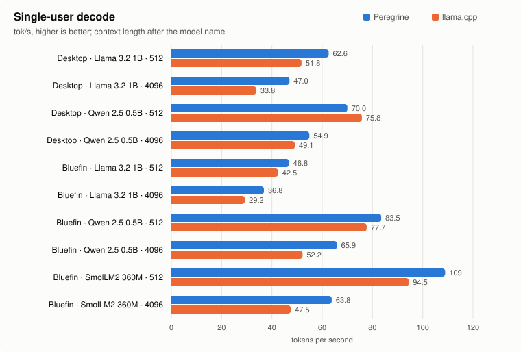
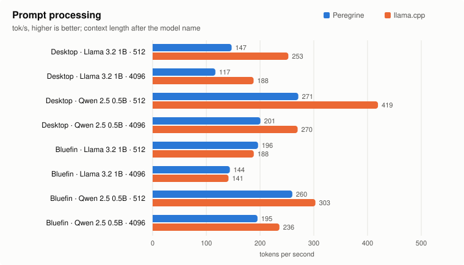
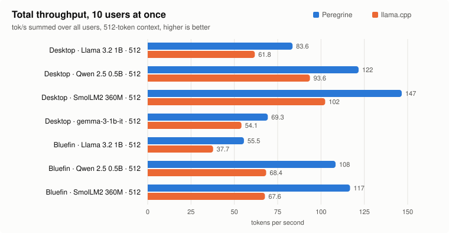
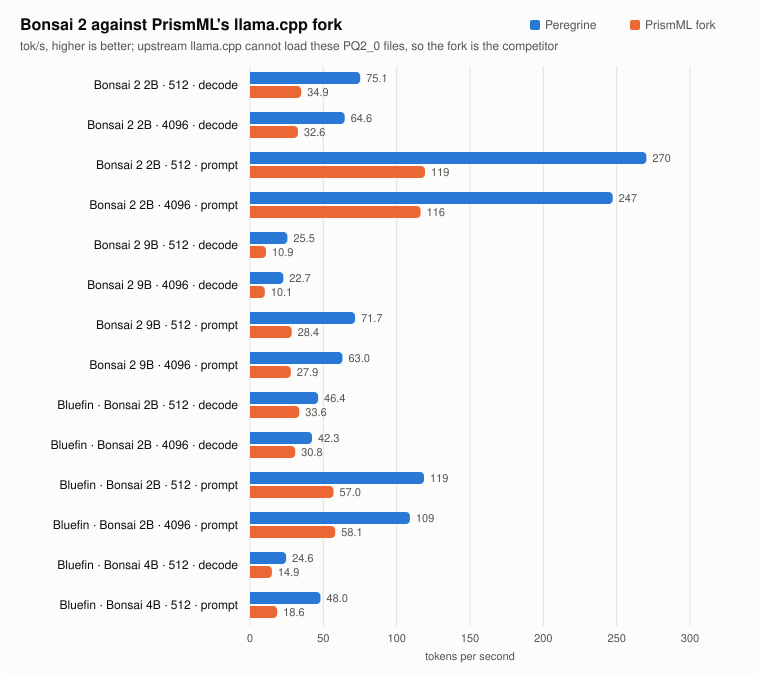

# Benchmarks: Peregrine against llama.cpp

Where Peregrine stands against llama.cpp on the same machine, the same model file and the same thread
count, and, on the desktop, against the ik_llama.cpp fork. Embedding and decision models are also
compared with OpenVINO, ONNX Runtime, fastembed and text-embeddings-inference. Wins and losses are both reported here. The raw data, method and machine records are in
[`benchmarks/results/`](../benchmarks/results/); the targets these numbers are held to are in
[targets.md](targets.md).


## Summary

- **Single-user decode wins every completed throughput row.** On the 12-core desktop, Peregrine leads
  llama.cpp's faster flash-attention setting by **1.13× to 1.69×**: Llama 3.2 1B is 1.31× at 512 and
  1.60× at 4096, Qwen 2.5 0.5B is 1.37× and 1.57×, SmolLM2 360M is 1.34× and 1.69×, and gemma-3-1b-it is
  1.35× and 1.13×. On the 4-core Ryzen 3 (bluefin) all three models are ahead, from **1.07× to 1.34×**.
  The lead grows with context because attention reads each cached key and value once per group of heads.
- **Multi-user throughput is 1.28–1.80× faster.** With 10 concurrent users, Peregrine serves **1.28–1.43×**
  llama.cpp's aggregate throughput on the 12-core desktop (1.13–1.38× at 4 users) and **1.47–1.80×** on
  the 4-core Ryzen 3 (1.80× on SmolLM2 360M at 4096; 1.73× at 512).
- **Prompt processing is ahead on all three hosts.** Prompt throughput is **1.03–1.30×** on the 12-core
  desktop, **1.03–1.43×** on the 4-core Ryzen 3, and **1.78–2.45×** on the 20-core ARM Cortex-X925/A725
  (`aarch64-neon-i8mm`).
- **Bonsai 2 (ternary): 1.4–2.3× decode, 1.9–2.6× prompt, and 1.8–2.8× with 10 users** against PrismML's
  llama.cpp fork across x86-64 (AVX-512 and AVX2) and ARM64 (NEON). Upstream llama.cpp cannot load
  `PQ2_0` files, so PrismML's fork is the comparison engine for ternary models.

- **Against ik_llama.cpp, prompt processing is behind.** On the desktop the fork processes prompts about
  twice as fast (Peregrine at 0.39-0.58×); decode is level (0.89-1.06×) and Peregrine is ahead with 10
  users (1.05-3.09×). See [Against ik_llama.cpp](#against-ik_llamacpp-desktop-avx-512).

- **Embeddings and decisions: fastest engine in 55 of 68 embedding cells and all nine decision cells on
  the 4-core Ryzen 3**, against llama.cpp, OpenVINO, ONNX Runtime, fastembed and
  text-embeddings-inference at equal accuracy. bge-m3, EmbeddingGemma, Qwen3-Embedding and Nemotron 3.5
  Embed are **1.18–1.62×** llama.cpp and decisions **1.33–1.84×**. The 13 cells behind are the two small
  BERT encoders at 128 and 512 tokens (**0.85–0.99×** OpenVINO and ONNX Runtime). On ARM every measured
  model is ahead of llama.cpp except four near-parity cells (0.95–0.99×). See
  [Embeddings, rerank and decisions](#embeddings-rerank-and-decisions).

**For chat models against llama.cpp, no completed throughput row is below 1.0×** on any host. The single remaining loss is time to first
token (TTFT) with 10 users on bluefin for Llama 3.2 1B at 4096 context (1.04×, Peregrine slower); at
512 context Peregrine is faster on every TTFT row (0.66–0.86× on bluefin, 0.70–0.86× on the desktop).

## Test machines

| | Desktop (H1) | Bluefin (H2) | DGX Spark (H3) |
|---|---|---|---|
| CPU | AMD Ryzen AI 9 HX 370 (Zen 5), 12C/24T | AMD Ryzen 3 PRO 4350G (Zen 2), 4C/8T | 10 × Cortex-X925 + 10 × Cortex-A725, 20C |
| SIMD tier | `x86_64-avx2-avx512-vnni-gfni-vbmi` | `x86_64-avx2` | `aarch64-neon-i8mm` / `aarch64-neon-dotprod` |
| Threads used | 12 (one per physical core) | 4 (one per physical core) | 10 (X925 cluster) and 20 (all cores) |
| OS | Linux (WSL2) | Fedora (bare metal) | Ubuntu Linux (bare metal) |
| Results | [`desktop-zen5-2026-11-09`](../benchmarks/results/desktop-zen5-2026-11-09/README.md) | [`bluefin-zen2-2026-11-08-q5`](../benchmarks/results/bluefin-zen2-2026-11-08-q5/README.md) | [`spark-arm-2026-11-09-i8mm`](../benchmarks/results/spark-arm-2026-11-09-i8mm/README.md) |

All comparisons run llama.cpp v0.9.0 (`cd959ba`) against Peregrine on the exact same GGUF files
(verified by SHA-256), with 256 greedy tokens per request, prompts calibrated to the target context,
three interleaved rounds, and the median reported. **Each ratio is measured against llama.cpp's faster
flash-attention setting (`-fa auto` or `-fa off`) for that specific row.**

## Single-user decode



| Machine | Model | Context | Peregrine (tok/s) | llama.cpp (tok/s) | Peregrine ÷ llama.cpp |
|---|---|---|---|---|---|
| Desktop | Llama 3.2 1B | 512 | 60.6 | 46.4 | **1.31×** |
| Desktop | Llama 3.2 1B | 4096 | 48.5 | 30.4 | **1.60×** |
| Desktop | Qwen 2.5 0.5B | 512 | 95.5 | 69.5 | **1.37×** |
| Desktop | Qwen 2.5 0.5B | 4096 | 71.9 | 45.8 | **1.57×** |
| Desktop | SmolLM2 360M | 512 | 102.9 | 77.0 | **1.34×** |
| Desktop | SmolLM2 360M | 4096 | 70.8 | 41.9 | **1.69×** |
| Desktop | gemma-3-1b-it | 512 | 59.9 | 44.3 | **1.35×** |
| Desktop | gemma-3-1b-it | 4096 | 46.3 | 41.0 | **1.13×** |
| Bluefin | Llama 3.2 1B | 512 | 46.8 | 42.5 | **1.10×** |
| Bluefin | Llama 3.2 1B | 4096 | 36.8 | 29.3 | **1.26×** |
| Bluefin | Qwen 2.5 0.5B | 512 | 83.5 | 77.7 | **1.07×** |
| Bluefin | Qwen 2.5 0.5B | 4096 | 65.9 | 52.2 | **1.26×** |
| Bluefin | SmolLM2 360M | 512 | 108.9 | 94.5 | **1.15×** |
| Bluefin | SmolLM2 360M | 4096 | 63.8 | 47.5 | **1.34×** |

## Prompt processing



| Machine | Model | Context | Peregrine (tok/s) | llama.cpp (tok/s) | Peregrine ÷ llama.cpp |
|---|---|---|---|---|---|
| Desktop | Llama 3.2 1B | 512 | 272.6 | 252.7 | **1.08×** |
| Desktop | Llama 3.2 1B | 4096 | 195.3 | 174.3 | **1.12×** |
| Desktop | Qwen 2.5 0.5B | 512 | 479.3 | 423.8 | **1.13×** |
| Desktop | Qwen 2.5 0.5B | 4096 | 355.1 | 272.4 | **1.30×** |
| Desktop | SmolLM2 360M | 512 | 451.1 | 436.3 | **1.03×** |
| Desktop | SmolLM2 360M | 4096 | 292.9 | 263.9 | **1.11×** |
| Desktop | gemma-3-1b-it | 512 | 284.9 | 258.1 | **1.10×** |
| Desktop | gemma-3-1b-it | 4096 | 279.6 | 247.9 | **1.13×** |
| Bluefin | Llama 3.2 1B | 512 | 195.7 | 188.1 | **1.04×** |
| Bluefin | Llama 3.2 1B | 4096 | 145.0 | 141.4 | **1.03×** |
| Bluefin | Qwen 2.5 0.5B | 512 | 434.8 | 303.7 | **1.43×** |
| Bluefin | Qwen 2.5 0.5B | 4096 | 277.6 | 236.5 | **1.17×** |
| Bluefin | SmolLM2 360M | 512 | 443.2 | 318.9 | **1.39×** |
| Bluefin | SmolLM2 360M | 4096 | 228.5 | 217.1 | **1.05×** |

## Multi-user throughput



| Machine | Model | 4 users (tok/s) | 10 users (tok/s) | 10 users, Peregrine ÷ llama.cpp |
|---|---|---|---|---|
| Desktop | Llama 3.2 1B | 70.3 vs 60.3 | 83.6 vs 61.8 | **1.35×** |
| Desktop | Qwen 2.5 0.5B | 108.4 vs 96.0 | 121.7 vs 93.6 | **1.30×** |
| Desktop | SmolLM2 360M | 117.1 vs 85.0 | 146.6 vs 102.4 | **1.43×** |
| Desktop | gemma-3-1b-it | 63.4 vs 49.6 | 69.3 vs 54.1 | **1.28×** |
| Bluefin | Llama 3.2 1B | 53.7 vs 39.6 | 55.5 vs 37.7 | **1.47×** |
| Bluefin | Qwen 2.5 0.5B | 104.3 vs 65.7 | 108.4 vs 68.4 | **1.59×** |
| Bluefin | SmolLM2 360M | 114.2 vs 66.2 | 116.8 vs 67.6 | **1.73×** |

Aggregate tokens per second across all concurrent users at a 512-token context. At a 4096-token context
on bluefin, Peregrine leads by **1.43×** (4 users) and **1.52×** (10 users) on Llama 3.2 1B, **1.35×**
and **1.40×** on Qwen 2.5 0.5B, and **1.55×** and **1.80×** on SmolLM2 360M.

## Against ik_llama.cpp (desktop, AVX-512)

ik_llama.cpp is the llama.cpp fork most often reported faster than upstream on x86. It runs the
same GGUF files, so it was measured on the desktop on 2026-11-11 with its best documented CPU
settings (an AVX-512 build, `-rtr` run-time repacking, its own flash attention), beside llama.cpp
and Peregrine in the same session. Ratios are Peregrine ÷ ik_llama.cpp; above 1 means Peregrine is
faster. Medians of three interleaved rounds.

| Model | Context | Decode (tok/s): Peregrine / ik | Ratio | Prompt (tok/s): Peregrine / ik | Ratio | 10 users (tok/s): Peregrine / ik | Ratio |
|---|---|---|---|---|---|---|---|
| Llama 3.2 1B | 512 | 56.6 / 54.6 | **1.04×** | 274.1 / 526.8 | 0.52× | 85.1 / 58.5 | **1.45×** |
| Llama 3.2 1B | 4096 | 40.6 / 42.3 | 0.96× | 208.4 / 359.0 | 0.58× | not completed | n/a |
| Qwen 2.5 0.5B | 512 | 93.9 / 91.9 | **1.02×** | 470.9 / 1116.9 | 0.42× | 150.4 / 100.4 | **1.50×** |
| Qwen 2.5 0.5B | 4096 | 65.3 / 69.1 | 0.95× | 379.1 / 662.9 | 0.57× | 20.2 / 6.5 | **3.09×** |
| SmolLM2 360M | 512 | 97.9 / 92.4 | **1.06×** | 426.5 / 1030.6 | 0.41× | 132.0 / 74.8 | **1.76×** |
| SmolLM2 360M | 4096 | 57.8 / 55.5 | **1.04×** | 304.5 / 556.0 | 0.55× | not measured | n/a |
| gemma-3-1b-it | 512 | 54.3 / 54.0 | **1.01×** | 254.3 / 644.7 | 0.39× | 76.3 / 72.7 | **1.05×** |
| gemma-3-1b-it | 4096 | 47.5 / 53.4 | 0.89× | 281.2 / 569.4 | 0.49× | not measured | n/a |

What this says:

- **Prompt processing: ik_llama.cpp is about twice as fast on every row** (Peregrine at 0.39-0.58×).
  This is Peregrine's largest measured loss. The fork repacks the k-quant weights at load (`-rtr`)
  for its own interleaved AVX-512 kernels. Where Peregrine's time goes in comparison has not been
  profiled yet.
- **Decode: level.** Peregrine is 1.01-1.06× at 512 context and 0.89-1.04× at 4096.
- **Many users: Peregrine is ahead on every completed row** (1.05-3.09× with 10 users), because it
  batches all users into one pass over the weights. At 4 users one row is behind (gemma-3-1b-it
  at 512 context, 0.85×).
- Time to first token with 10 users is behind on two 512-context rows (SmolLM2 1.09× and
  gemma-3-1b-it 1.34× of ik_llama.cpp's time) and ahead on the others.

Not measured: OpenVINO GenAI, the 4096-context multi-user rows for SmolLM2 and gemma-3-1b-it, and
ik_llama.cpp on bluefin and on ARM. The 4096-context multi-user rows are single rounds. Method,
settings and raw data: [`benchmarks/results/desktop-zen5-2026-11-11-ik/`](../benchmarks/results/desktop-zen5-2026-11-11-ik/README.md).
The other tables on this page were measured earlier and against llama.cpp only.

## Bonsai 2 (ternary) vs PrismML's fork

Bonsai 2's ternary models (`PQ2_0`, ggml type 142) are compared against
[PrismML's llama.cpp fork](https://github.com/PrismML-Eng/llama.cpp) (`62c418c`, branch `prism`).
"Fork best" is the faster of the fork's flash-attention settings (`-fa on` or `-fa off`) for each row.
Full manifests: [desktop](../benchmarks/results/2026-11-09-bonsai2-prism/) and
[bluefin](../benchmarks/results/bluefin-zen2-2026-11-08-bonsai2-prism/).



### Desktop (12 cores, AVX-512)

| Model | Context | Users | Metric | Peregrine | Fork best | Ratio |
|---|---|---|---|---|---|---|
| Bonsai 2 2B PQ2_0 | 512 | 1 | Decode tok/s | 75.14 | 34.89 | **2.15×** |
| Bonsai 2 2B PQ2_0 | 512 | 1 | Prompt tok/s | 270.24 | 119.35 | **2.26×** |
| Bonsai 2 2B PQ2_0 | 512 | 10 | Aggregate tok/s | 75.77 | 29.56 | **2.56×** |
| Bonsai 2 2B PQ2_0 | 512 | 10 | TTFT (s) | 14.10 | 44.38 | **0.32×** |
| Bonsai 2 2B PQ2_0 | 4096 | 1 | Decode tok/s | 64.60 | 32.65 | **1.98×** |
| Bonsai 2 2B PQ2_0 | 4096 | 1 | Prompt tok/s | 247.30 | 116.35 | **2.13×** |
| Bonsai 2 9B PQ2_0 | 512 | 1 | Decode tok/s | 25.47 | 10.92 | **2.33×** |
| Bonsai 2 9B PQ2_0 | 512 | 1 | Prompt tok/s | 71.65 | 28.45 | **2.52×** |
| Bonsai 2 9B PQ2_0 | 512 | 10 | Aggregate tok/s | 21.66 | 7.87 | **2.75×** |
| Bonsai 2 9B PQ2_0 | 512 | 10 | TTFT (s) | 52.12 | 181.96 | **0.29×** |
| Bonsai 2 9B PQ2_0 | 4096 | 1 | Decode tok/s | 22.69 | 10.12 | **2.24×** |
| Bonsai 2 9B PQ2_0 | 4096 | 1 | Prompt tok/s | 63.04 | 27.85 | **2.26×** |

With lossless multi-token prediction (MTP) on the 9B `-MTP-Q8_0` model (512 context, 1 user), Peregrine
decodes at **28.80 tok/s** (1.15× over its non-speculative 25.14 tok/s, and **3.09×** against the fork's
9.33 tok/s with `--spec-type draft-mtp`).

### Bluefin (4 cores, AVX2)

| Model | Context | Users | Metric | Peregrine | Fork best | Ratio |
|---|---|---|---|---|---|---|
| Bonsai 2 2B PQ2_0 | 512 | 1 | Decode tok/s | 46.40 | 33.63 | **1.38×** |
| Bonsai 2 2B PQ2_0 | 512 | 1 | Prompt tok/s | 118.67 | 56.95 | **2.08×** |
| Bonsai 2 2B PQ2_0 | 512 | 10 | Aggregate tok/s | 33.69 | 19.08 | **1.77×** |
| Bonsai 2 2B PQ2_0 | 512 | 10 | TTFT (s) | 32.82 | 82.05 | **0.40×** |
| Bonsai 2 2B PQ2_0 | 4096 | 1 | Decode tok/s | 42.28 | 30.79 | **1.37×** |
| Bonsai 2 2B PQ2_0 | 4096 | 1 | Prompt tok/s | 109.04 | 58.07 | **1.88×** |
| Bonsai 2 4B PQ2_0 | 512 | 1 | Decode tok/s | 24.59 | 14.95 | **1.64×** |
| Bonsai 2 4B PQ2_0 | 512 | 1 | Prompt tok/s | 48.05 | 18.55 | **2.59×** |
| Bonsai 2 4B PQ2_0 | 512 | 10 | Aggregate tok/s | 14.12 | 6.37 | **2.22×** |
| Bonsai 2 4B PQ2_0 | 512 | 10 | TTFT (s) | 78.84 | 279.73 | **0.28×** |

## ARM64 NEON and i8mm (DGX Spark)

Measured on the 20-core DGX Spark (10 × Cortex-X925 + 10 × Cortex-A725, `aarch64-neon-i8mm` and
`aarch64-neon-dotprod`) at a 512-token context:

| Model | Threads | Metric | Peregrine (tok/s) | Competitor (tok/s) | Ratio |
|---|---|---|---|---|---|
| Llama 3.2 1B Q4_K_M | 10 (X925) | Prompt tok/s | 573.8 | 234.2 (llama.cpp) | **2.45×** |
| Llama 3.2 1B Q4_K_M | 10 (X925) | Decode tok/s | 112.9 | 99.0 (llama.cpp) | **1.14×** |
| Llama 3.2 1B Q4_K_M | 20 (all) | Prompt tok/s | 629.8 | 322.0 (llama.cpp) | **1.96×** |
| Llama 3.2 1B Q4_K_M | 20 (all) | Decode tok/s | 111.6 | 86.4 (llama.cpp) | **1.29×** |
| Qwen 2.5 0.5B Q4_K_M | 10 (X925) | Prompt tok/s | 935.3 | 524.5 (llama.cpp) | **1.78×** |
| Qwen 2.5 0.5B Q4_K_M | 10 (X925) | Decode tok/s | 199.9 | 194.2 (llama.cpp) | **1.03×** |
| Qwen 2.5 0.5B Q4_K_M | 20 (all) | Prompt tok/s | 886.9 | 547.5 (llama.cpp) | **1.62×** |
| Qwen 2.5 0.5B Q4_K_M | 20 (all) | Decode tok/s | 198.8 | 128.3 (llama.cpp) | **1.55×** |
| Bonsai 2 2B PQ2_0 | 10 (X925) | Prompt tok/s | 404.0 | 167.7 (PrismML fork) | **2.41×** |
| Bonsai 2 2B PQ2_0 | 10 (X925) | Decode tok/s | 140.4 | 88.7 (PrismML fork) | **1.58×** |
| Bonsai 2 2B PQ2_0 | 20 (all) | Prompt tok/s | 433.1 | 200.5 (PrismML fork) | **2.16×** |
| Bonsai 2 2B PQ2_0 | 20 (all) | Decode tok/s | 146.8 | 64.5 (PrismML fork) | **2.28×** |
| Bonsai 2 4B-MTP PQ2_0 | 10 (X925) | Decode tok/s (MTP on) | 80.7 | 50.8 (PrismML fork) | **1.59×** |
| Bonsai 2 4B-MTP PQ2_0 | 20 (all) | Prompt tok/s | 185.2 | 80.9 (PrismML fork) | **2.29×** |
| Bonsai 2 4B-MTP PQ2_0 | 20 (all) | Decode tok/s | 67.7 | 32.5 (PrismML fork) | **2.08×** |

Full details: [`spark-arm-2026-11-09-i8mm`](../benchmarks/results/spark-arm-2026-11-09-i8mm/README.md)
and [`spark-arm-2026-11-10-bonsai2`](../benchmarks/results/spark-arm-2026-11-10-bonsai2/README.md).

## Embeddings, rerank and decisions

Embedding and decision models are compared with every engine that can run the model on the host, not
only llama.cpp. A ratio is Peregrine ÷ the fastest other engine **at equal accuracy** for that cell:
engines whose vectors drift from the full-precision reference (the int8 ONNX exports, at cosine
0.92–0.98) are shown in the raw tables and left out of the ratios. The embedding result cache is off
for every timed row, so every engine computes every text.

### Bluefin (4 cores, AVX2): every engine

4 threads, three interleaved rounds, medians. Cells are 16, 128 and 512
tokens at batch 1, 8 and 32, a mixed-length batch of 32 texts (8–512 tokens), and 2 000 tokens for the
models that accept them. Engines: llama.cpp v0.9.0, OpenVINO 2026.4, ONNX Runtime 1.31, fastembed 0.9
and text-embeddings-inference 1.9. The four larger families are the S4.9l proof run at `2a5e9f6`; the
two small BERT rows are re-measured at `4500a6f` plus S4.9p
([`bluefin-2026-11-12-s4.9p`](../benchmarks/results/bluefin-2026-11-12-s4.9p/README.md)).

| Model | File | Fastest other engine | 16 tokens | 128 tokens | 512 tokens | 2 000 tokens | mixed batch |
|---|---|---|---|---|---|---|---|
| all-MiniLM-L6-v2 | F16, Q8_0 | OpenVINO, ONNX Runtime | **1.10–1.39×** | 0.98–1.03× | 0.90–0.95× | n/a | **1.52×** |
| bge-small-en-v1.5 | F32, Q8_0 | OpenVINO, ONNX Runtime, fastembed | 0.97–1.26× | 0.92–0.97× | 0.84–0.89× | n/a | **1.25×** |
| bge-m3 | Q8_0 | llama.cpp | **1.18–1.53× across every cell** | | | **1.35×** | |
| EmbeddingGemma 300M | Q8_0 | llama.cpp | **1.30–1.51× across every cell** | | | | |
| Qwen3-Embedding 0.6B | Q8_0, F16 | llama.cpp | **1.25–1.51×** (Q8_0), **1.24–1.44×** (F16) | | | | |
| Nemotron 3.5 Embed 1B | Q8_0 | llama.cpp | **1.34–1.62× across every cell** | | | | |

The four larger families are ahead in every cell (1.05× and up). The cells behind are all on the two
small BERT encoders at 128 and 512 tokens: MiniLM F16/Q8_0 lose at 128 b8 (0.98–0.99×) and 512
b1/b8/b32 (0.90–0.95×), bge-small F32/Q8_0 at 16 b32 (0.97×), 128 b1/b8/b32 (0.92–0.97×) and 512
b1/b8/b32 (0.84–0.89×). The stage profile says where: at 512 tokens the pass is 58–60% matmul, 23–25%
attention and 17% element-wise, and OpenVINO's own per-node profile on the same cell puts its
`FullyConnected` at 173 GMAC/s against Peregrine's 165–178 — the matrix kernels are level, while the
element-wise work is 9.3 ms against OpenVINO's 0.5 ms (18.1 against 1.1 on bge-small) and bge-small's
attention is 25.7 against 20.7 ms. So the remainder is the per-element passes and bge-small's 32-wide
attention strip, not the matrix kernel and not quantisation (the F16/F32 and Q8_0 rows still run at
the same speed). S4.9p closed the halved-precision kernel's conversion overhead and moved MiniLM's
F16 row 0.87→0.90× at 512 b1 and 0.96→1.02× at 128 b1; the element-wise block is the next lever. The
mixed-length batch is a win on both models because Peregrine never pads: the padding engines are
1.6–4.5× slower there.

Accuracy on the same texts: Q8_0 agrees with llama.cpp's Q8_0 within 3e-4 cosine and is closer to the
fp32 reference on all three BERT models; the F16 and F32 rows are exact against the fp32 engines;
Nemotron's F16 vectors are at cosine 0.9999998 to llama.cpp's.

**Decisions** (`POST /v1/systemone`, `tinyopenjev` Q8_0; llama.cpp with one slot per question,
`-np 11 -c 16384`), questions per second:

| State tokens | Questions | Peregrine | llama.cpp | Ratio |
|---:|---:|---:|---:|---:|
| 64 | 1 | 179.2 | 97.5 | **1.84×** |
| 64 | 3 | 243.9 | 161.3 | **1.51×** |
| 64 | 10 | 310.1 | 203.2 | **1.53×** |
| 300 | 1 | 64.7 | 46.4 | **1.39×** |
| 300 | 3 | 116.4 | 86.5 | **1.35×** |
| 300 | 10 | 198.8 | 133.0 | **1.50×** |
| 1000 | 1 | 20.7 | 15.6 | **1.33×** |
| 1000 | 3 | 48.8 | 35.7 | **1.37×** |
| 1000 | 10 | 95.3 | 67.6 | **1.41×** |

Full details, per-cell tables, stage profiles and the excluded rows:
[`bluefin-2026-11-12-s4.9l-proof`](../benchmarks/results/bluefin-2026-11-12-s4.9l-proof/README.md).

### DGX Spark (ARM64): against llama.cpp

10 threads (the Cortex-X925 cluster), `aarch64-neon-i8mm`, llama.cpp v0.9.0 with one slot per text.

| Model | File | One text (16 to 2 000 tokens) | Batch of 32 | Mixed batch of 32 |
|---|---|---|---|---|
| EmbeddingGemma 300M | Q8_0 | **1.98–2.47×** | **1.91×** | **1.94×** |
| Qwen3-Embedding 0.6B | Q8_0 | **1.33–2.20×** | **2.02×** | **1.93×** |
| Qwen3-Embedding 0.6B | F16 | **1.05–1.52×** | **2.72–3.21×** | **1.11×** |
| Nemotron 3.5 Embed 1B | Q8_0 | **2.37–2.65×** | **2.63×** | **2.63×** |
| bge-m3 | Q8_0 | **1.83–2.10×** | **2.03×** | **2.02×** |
| gte-modernbert-base | F16 | **1.42–1.56×** | **1.15×** (16 texts) | n/a |
| gte-modernbert-base | Q8_0 | **1.43–1.77×** (16 to 512 tokens) | **1.55×** (16 texts) | n/a |

The batch cells are the largest wins because llama.cpp runs one embedding task at a time inside a
request while Peregrine shares weight passes across the texts. No cell in this table is behind
after S4.9q, which added the missing `i8mm` body for the Q8_0 int8 tile (`smmla` instead of
`sdot`, 3.05× the kernel, 1.5–2.6× the whole pass) — before it, nine cells of these four Q8_0
files were at or below 1.0×. The narrowest now is Qwen3-Embedding Q8_0 at one 2 000-token text
(1.33×), whose attention-heavy pass and llama.cpp's CPU flash attention are the reason it is
close. Q8_0 ModernBERT was behind from 128 tokens up (0.77–0.94×) until S4.9o: a Q8_0
ModernBERT file of up to 256 MiB now has its matrices widened to float at load, which is both
faster (1.28–2.04× the old pass) and closer to the full-precision vectors, at four times the
weight memory.

Full details: [`spark-arm-2026-11-12-q8-i8mm`](../benchmarks/results/spark-arm-2026-11-12-q8-i8mm/README.md)
(the Q8_0 int8-tile rows, before/after the `i8mm` body),
[`spark-2026-11-12-embeddings`](../benchmarks/results/spark-2026-11-12-embeddings/README.md),
[`spark-arm-2026-11-12-modern-bert`](../benchmarks/results/spark-arm-2026-11-12-modern-bert/README.md)
(the F16 row) and [`spark-arm-2026-11-12-q8-encoders`](../benchmarks/results/spark-arm-2026-11-12-q8-encoders/README.md)
(the Q8_0 ModernBERT row).

### Rerank

`POST /v1/rerank` on bge-reranker-v2-m3 and bge-reranker-base gives the same token ids and the same
ranking order as llama.cpp on the reference pairs (320 pairs, eight languages:
[reference/bert.md](reference/bert.md)).

Bluefin, 4 threads, one query against 1, 8 and 32 documents of 123 and 449 tokens, both engines on the
same GGUF, one engine at a time through HTTP, median of five requests (`scripts/rerank-bench.py`).
llama.cpp got one slot per document of the largest request (`-np 32 -c 16640 -b 1024 -ub 1024
--reranking`); Peregrine ran `serve --threads 4 --ctx 16640`, which clamps to the file's 8 192 and runs
32 rows per pass. Pairs per second:

| File | tokens/pair | documents | Peregrine | llama.cpp | Ratio |
|---|---|---:|---:|---:|---:|
| bge-reranker-v2-m3 Q8_0 | 123 | 1 / 8 / 32 | 3.87 / 3.91 / 3.92 | 3.31 / 2.77 / 2.76 | **1.17× / 1.41× / 1.42×** |
| bge-reranker-v2-m3 Q8_0 | 449 | 1 / 8 / 32 | 0.96 / 0.96 / 0.96 | 0.78 / 0.73 / 0.73 | **1.23× / 1.32× / 1.32×** |
| bge-reranker-base Q8_0 | 123 | 1 / 8 / 32 | 12.37 / 13.11 / 13.14 | 11.10 / 9.66 / 9.68 | **1.11× / 1.36× / 1.36×** |
| bge-reranker-base Q8_0 | 449 | 1 / 8 / 32 | 3.25 / 3.26 / 3.25 | 2.76 / 2.52 / 2.52 | **1.18× / 1.29× / 1.29×** |

The top-1 document agrees in every cell. bge-reranker-base's whole ranking is identical (Kendall
τ = 1.000, largest score difference 0.10); v2-m3 swaps one adjacent pair at each length, and those
two documents are 0.013–0.018 apart in llama.cpp's own scores — smaller than the engines' score
difference on the same document (0.04–0.11), so the swap is the near-tie. Method, flags and the full
data: [`bluefin-2026-11-12-s4.9p`](../benchmarks/results/bluefin-2026-11-12-s4.9p/README.md).

## Task accuracy and decoding invariance

Speed numbers are paired with the task-accuracy gate and decoding-invariance suite in
[`docs/dev/accuracy.md`](dev/accuracy.md) and [`benchmarks/accuracy/`](../benchmarks/accuracy/):

- **Task accuracy (GSM8K 250, MMLU 500, HumanEval+ 163):** all four gate models
  (Qwen 2.5 0.5B Instruct, Llama 3.2 1B Instruct, gemma-3-1b-it, Qwen 3 1.7B, Q4_K_M) pass every
  paired check against same-host llama.cpp (`|Δ| ≤ 4` percentage points, exact McNemar `p ≥ 0.12`) and
  the BF16 vLLM floor across all three hardware tiers — AVX2, AVX-512, and ARM64 NEON i8mm.
- **Batch and speculation invariance:** 520 prompts decoded alone, in concurrent batches of 8, and
  with `--speculate` produce **520/520 byte-identical replies** on every host and tier.

## Reproducing

```sh
python3 benchmarks/run.py --help     # run the benchmark harness on a model and engine
python3 benchmarks/charts.py         # regenerate the SVG charts in docs/img/
```
